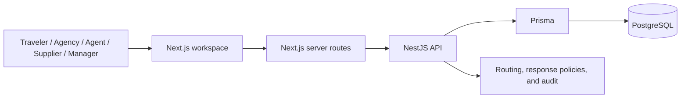

# OpsDesk — Connected Travel Support

A travel support workspace that connects each case to its booking, traveler, agency, earlier cases, and supplier conversations. Teams can route work, manage response deadlines, review booking requests, and track operational trends from one place.

**Stack:** Next.js · NestJS · Prisma · PostgreSQL

[Features](#-features) · [Architecture](#-architecture) · [Quick start](#-quick-start) · [Workflows](#-workflows) · [Testing](#-testing) · [Documentation](#-documentation)

---

## 💡 Why it exists

Travel support rarely fits into one ticket. A complaint may depend on a booking, a previous case, a supplier response, and an agency's service commitments. OpsDesk keeps that context connected while showing each role only the records it is allowed to see.

## ✨ Features

| Area | What it does |
| --- | --- |
| 🎫 Connected cases | Links complaints to bookings, travelers, agencies, and authorized case history. |
| 📥 Shared inbox | Provides regional queues, search and filters, ownership, priorities, and manager reassignment. |
| 🧭 Routing and coverage | Assigns work using region, specialty, availability, and capacity; supports optional automatic handoff when coverage changes. |
| 💬 Separate conversations | Keeps customer replies, internal notes, and supplier threads distinct, with API-enforced role boundaries. |
| ⏱️ Response policies | Tracks agency and supplier targets with calendars, time zones, holidays, escalation rotations, and audited holds. |
| 🧳 Booking requests | Lets agencies propose bookings or request cancellations, customers request cancellations, and managers review decisions. |
| 📊 Insights and exports | Shows operational metrics and issue trends; exports cases within the caller's queue scope. |
| 🔐 Membership controls | Supports invitations, activation, suspension, and scoped agency and supplier access. |
| 📝 Assisted drafting | Creates records-based case briefs and editable reply drafts. External AI and live email delivery are not configured in the local setup. |

## 🏗 Architecture



The browser uses Next.js server routes to reach the API. Travel endpoints live under `/ops/*`. PostgreSQL stores cases, booking context, messages, policies, and audit history. The local launcher also uses PostgreSQL-backed session revocation and rate-limit counters; production requires Redis.

## 📸 Screenshots

Static screenshots use synthetic records.

| Shared inbox | Connected case |
| :---: | :---: |
| [](docs/assets/inbox-overview.png) | [](docs/assets/connected-case.png) |
| **Insights** | **Membership** |
| [](docs/assets/insights-overview.png) | [](docs/assets/membership-overview.png) |

## 🚀 Quick start

Use **Node.js 22.23.x** and npm. The local launcher uses embedded PostgreSQL, so Docker and a separate database account are unnecessary.

```sh
git clone https://github.com/KrishChadha001/opsdesk-travel-support.git
cd opsdesk-travel-support
npm ci
npm run ops:preview
```

Open [http://127.0.0.1:3000](http://127.0.0.1:3000). The API starts on port 3001. On Windows, `Start-OpsDesk.cmd` can launch the same local workspace. Use `npm run ops:dev` for frontend live reload.

The launcher creates local configuration, starts PostgreSQL on `127.0.0.1:55432`, applies migrations, seeds synthetic records, and builds the apps. It preserves existing configuration and records in the ignored `.opsdesk/postgres` directory. Run one launcher at a time; the first start may take longer while dependencies and database binaries install.

For a dedicated development database, run `npm run ops:setup`, set `DATABASE_URL` in `backend/.env`, then run `npm run ops:preview -- --external-db`. See the [setup guide](OPSDESK_README.md) for configuration details.

## 🎮 Workflows

- **Agent or manager:** Open a case, inspect its booking and earlier authorized history, reply to the customer, or add a private internal note.
- **Supplier:** Continue a supplier thread without gaining access to the customer's private case workspace.
- **Agency or traveler:** Review scoped bookings and submit the available booking or cancellation requests.
- **Manager:** Review booking decisions, adjust ownership and coverage, configure response policies, and inspect Insights.

The local seed includes synthetic agencies, travelers, bookings, cases, agents, managers, and suppliers. Account details and a guided scenario are in the [setup guide](OPSDESK_README.md).

## 🧪 Testing

Run the application checks against an isolated local workspace:

```sh
npm run ops:test
npx playwright install chromium
npm run ops:test:browser
```

`ops:test` covers unit and HTTP regression suites, including role scope, booking requests, response policies, and concurrency. `ops:test:browser` runs browser workflows and accessibility checks. See the [validation record](docs/OPSDESK_VALIDATION.md) for results, limits, and any checks still awaiting manual acceptance.

## 🧠 Engineering notes

- **Scope is enforced in the API.** Inbox data, booking history, supplier conversations, and CSV exports follow the caller's role and queue permissions.
- **Deadlines retain their policy context.** Agency contracts and supplier response cycles use the policy in effect when the relevant work begins; changing a policy does not silently rewrite saved deadlines.
- **Handoffs are explicit and audited.** Optional automatic handoff responds to coverage changes, while manual assignment takes precedence.
- **Synthetic data stays local.** The starter workspace uses fictional records. External booking providers, live email delivery, and external AI are not enabled by the local setup.
- **Production rollout remains paused.** Access rules, staging, backup and restore, monitoring, integrations, and further acceptance work are tracked in the project documentation.

## 📚 Documentation

| Guide | Covers |
| --- | --- |
| [Setup and local workflows](OPSDESK_README.md) | Launcher, configuration, accounts, and role journeys |
| [Developer handoff](docs/OPSDESK_HANDOFF.md) | Architecture and implementation notes |
| [Response policies](docs/OPSDESK_SLA_CALENDARS.md) | Calendars, contracts, coverage, and escalation |
| [Booking requests](docs/OPSDESK_BOOKING_APPROVALS.md) | Request and review flows |
| [Validation](docs/OPSDESK_VALIDATION.md) | Test evidence and known limitations |
| [Backlog](docs/OPSDESK_BACKLOG.md) | Remaining work and acceptance criteria |
| [Sources](docs/OPSDESK_SOURCES.md) | Reference data and attribution |

Built on the [IT Helpdesk foundation](https://github.com/Molnar-Zoltan/it-helpdesk). Its original history and authorship are retained.
